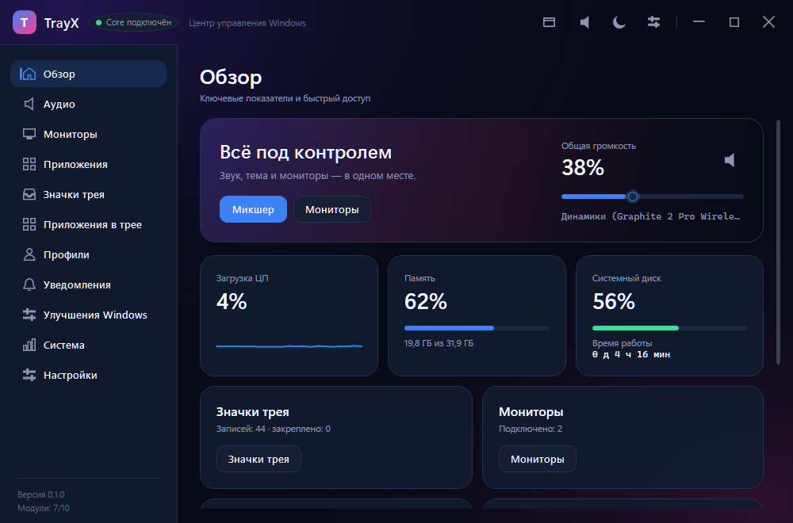
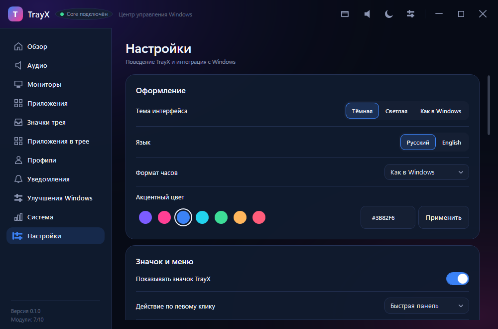

# TrayX

**Windows System Tray Enhancement** — модернизация системного трея Windows: управление значками, звуком, быстрыми настройками, мониторами и автоматизацией.

[](https://github.com/Smirty8181/TrayX/releases/latest)

**Технологии:** C#, .NET 10, WPF и Windows API. PowerShell используется для сборки и запуска. TrayX в этом репозитории не содержит Rust-кода.

## Скриншоты

Скриншоты работающего TrayX Control Center в Windows:





## Текущее состояние

Основной продукт — постоянно работающий `TrayX.Core` с интеграцией в системный трей Windows. WPF Control Center подключается к Core по именованному каналу и управляет тем же runtime.

Реализовано:

- собственный значок TrayX через `Shell_NotifyIcon`, контекстное меню, быстрые действия, уведомления и восстановление значка после перезапуска Explorer;
- чтение видимых значков из настоящей панели задач Windows 11 через UI Automation, в том числе на дополнительных мониторах;
- отдельная панель TrayX на каждом дополнительном мониторе: показывает часы, дублирует доступные значки штатной панели Windows с реальными действиями активации/контекстного меню, позволяет открыть штатную скрытую область и Control Center; изображения значков загружаются в фоне, а панель включается отдельно для каждого экрана;
- список зарегистрированных значков из пользовательского `NotifyIconSettings`, закрепление и переход к применению параметров перезапуском Explorer только по явной команде пользователя;
- быстрый доступ к значкам панели и скрытой области, звуку, яркости, календарю и настройкам через Control Center;
- управление громкостью и Mute для доступных endpoint-устройств ввода/вывода и отдельных аудиосессий приложений; выбор устройства по умолчанию для ролей Console/Multimedia/Communications, событийное обновление списка аудиоустройств и сессий, уведомления о подключении, избранные устройства и индикатор уровня микрофона;
- компактный аудиомикшер, регулировка колесом мыши, предупреждение о высокой громкости и переход в классическую панель звука;
- настройки внешнего вида, поведения, интервала обновления и запуска вместе с Windows;
- отдельные процессы Core и UI, IPC, локальное хранение настроек и профилей, журналы и тесты.

TrayX дополняет Windows, но не подменяет системную оболочку: приложение не внедряется в Explorer и не меняет системные файлы. Панель второго монитора — собственное окно TrayX, а не перенесённая системная панель задач. Значки приложений отображаются как быстрые действия, привязанные к доступным элементам UI Automation; сама Windows и её штатный трей остаются на месте. Подробные технические ограничения перечислены в [ADR-0003](docs/Architecture/adr/0003-real-tray-integration.md). Скрытые значки Windows перечисляет только пока открыта область переполнения; некоторые настройки закрепления применяются после перезапуска Explorer. Переключение default audio endpoint использует Windows Audio Policy COM API, который не является документированным публичным API; при недоступности интерфейса TrayX открывает системные звуковые параметры.

## Приоритеты разработки

- **P0 — системный трей и интеграция с Windows.** Работающий Core с собственным значком, меню и чтением реального трея уже есть. Следующий критерий — закрыть пробелы поведения и покрыть интеграцию тестами; подмена Explorer в проект не входит.
- **P1 — мониторы, значки, звук, уведомления и персонализация.** Основные модули и связь с Control Center реализованы; продолжать их развитие после проверки P0.
- **P2 — производительность, стабильность, тестирование, установщик и обновления.** Сборка и unit/integration-тесты настроены; установщик и обновления остаются отдельной работой.
- **P3 — файловый менеджер и интеграция с Проводником.** Не начинать до завершения основного трея; подключать как независимое расширение.
- **P4 — ИИ, облачные функции и остальные расширения.** Не начинать до завершения приоритетов системного трея.

## Требования

- Windows 11 22H2 или новее (build 22621+).
- .NET SDK `10.0.403` (закреплён в `global.json`, предварительные версии отключены).

## Сборка и запуск

```powershell
.\scripts\build.ps1
```

```powershell
.\scripts\run-core.ps1
.\scripts\run-ui.ps1
```

Скрипты автоматически подхватывают SDK из `%LOCALAPPDATA%\Microsoft\dotnet`, если он установлен пользовательски. Ручные команды:

```powershell
dotnet restore .\TrayX.sln
dotnet build .\TrayX.sln -c Release
dotnet test .\TrayX.sln -c Release
```

`.\scripts\build.ps1` выполняет restore, Release-сборку и unit/integration-тесты решения. UI automation tests и performance tests пока не реализованы и не входят в solution; также пока нет установщика. Для ручных сценариев используйте [чек-лист](docs/MANUAL_TESTS.md).

## Скачать

Готовый пакет для Windows 11 x64 доступен на странице [последнего релиза](https://github.com/Smirty8181/TrayX/releases/latest). Распакуйте архив и запустите `Start-TrayX.ps1`; для локальной сборки и запуска из исходников используйте `.\scripts\run-core.ps1` и `.\scripts\run-ui.ps1`.

## Структура

```text
TrayX/
├── src/
│   ├── TrayX.Domain/          сущности, события, правила
│   ├── TrayX.Application/     сценарии, DTO, интерфейсы
│   ├── TrayX.Contracts/       контракты IPC
│   ├── TrayX.Windows/         Win32, Shell, Audio, Display, Devices
│   ├── TrayX.Storage/         SQLite, репозитории, миграции
│   ├── TrayX.Modules/         функции TrayManager, AudioCenter, ...
│   ├── TrayX.Core/            фоновый процесс
│   └── TrayX.UI/              WPF-приложение
├── tests/
├── docs/
├── assets/
└── scripts/
```

## Ограничения

TrayX не модифицирует `explorer.exe`, не внедряет DLL и не подменяет системные файлы. Возможности, для которых нет документированного API, будут реализованы настолько глубоко, насколько это безопасно, с честным описанием ограничений.

Подробнее — [docs/Architecture/overview.md](docs/Architecture/overview.md).
Срез фактической готовности модулей: [docs/STATUS.md](docs/STATUS.md); ограничения и сценарии ручной проверки: [docs/LIMITATIONS.md](docs/LIMITATIONS.md) и [docs/MANUAL_TESTS.md](docs/MANUAL_TESTS.md).
Полный перечень известных дефектов, рисков и недоделок с приоритетами: [docs/TODO.md](docs/TODO.md).
Способы управления плитками Quick Settings: [docs/QUICK_SETTINGS_MATRIX.md](docs/QUICK_SETTINGS_MATRIX.md).
Текущий эффект и проверки сохраняемых настроек: [docs/SETTINGS_MAP.md](docs/SETTINGS_MAP.md).
